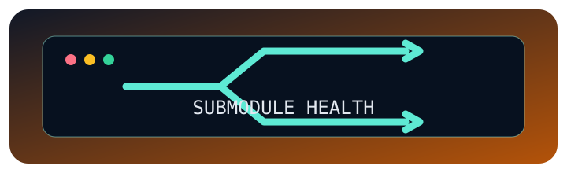

<p align="center"></p>
<p align="center"></p>
<p align="center">   </p>
<p align="center"></p>

## 🧭 Overview
Git Submodule Audit reads `.gitmodules` and compares each configured path with the working tree. It flags missing paths, uninitialized directories, and local-only URLs that may not work for collaborators.

## ✨ Features
- 🧩 Read submodule names, paths, and URLs from `.gitmodules`
- 📂 Detect missing paths and uninitialized submodule directories
- ⚠️ Flag file URLs and absolute local paths
- 🔒 Never runs `git submodule update` or modifies the repository

## 🖥️ Demo
No hosted demo is provided. Run the tool locally using the quick-start command.

## 🚀 Quick Start
Requires Python 3.10 or newer.

```bash
python main.py ./
```

Run the test suite with:

```bash
python -m unittest discover -s tests -v
```

## 🧰 Tech Stack
- Python standard library
- `argparse` CLI and `unittest`
- Read-only inspection by default

## 🗂️ Folder Structure
```text
.
├── .github/workflows/ci.yml
├── assets/mark.svg
├── tests/test_main.py
├── main.py
├── pyproject.toml
└── README.md
```

## 🗺️ Roadmap
- [ ] Add more edge-case fixtures
- [ ] Improve machine-readable output
- [ ] Keep the core workflow dependency-free

## 🤝 Contributing
Issues and focused pull requests are welcome. Add regression tests for parser and reporting changes.

## 📄 License
MIT License. See [LICENSE](LICENSE).

<p align="center"></p>
